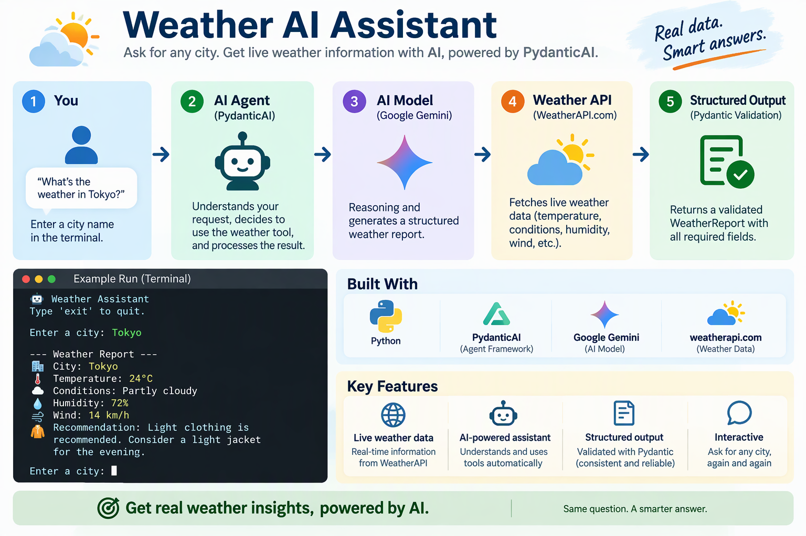

# 🌦️ Weather AI Assistant

An AI-powered weather assistant built with PydanticAI, Google Gemini, and WeatherAPI. The application retrieves live weather data for any city, uses an AI agent to process the results, and returns a structured weather report with recommendations.

# 🚀 Features
✅ Live weather data from WeatherAPI
✅ AI-powered reasoning using Google Gemini
✅ Tool-calling via PydanticAI
✅ Structured and validated outputs using Pydantic
✅ Interactive terminal-based chatbot experience
✅ Continuous conversation loop until user exits
✅ Clothing recommendations based on weather conditions

# 🏗️ Architecture
Plain Text
User
↓
PydanticAI Agent
↓
Google Gemini
↓
Weather Tool
↓
WeatherAPI
↓
Live Weather Data
↓
Pydantic Validation
↓
Structured Weather Report

# 🧩 Technologies Used
Technology	Purpose
Python	Application runtime
PydanticAI	AI Agent framework
Google Gemini	AI model
WeatherAPI	Live weather data provider
Pydantic	Structured output validation
Requests	API communication
Python Dotenv	Environment variable management

# 🤖 How the AI Agent Works

This project demonstrates a tool-using AI agent.

Unlike a traditional chatbot that responds from its training alone, this agent can:

Understand the user's request.
Determine that weather information is needed.
Call a Python tool to retrieve live weather data.
Analyze the returned information using Gemini.
Generate a validated weather report.

Example:

Plain Text
User:
What's the weather in Tokyo?
 
Agent:
→ Calls WeatherAPI
→ Receives live weather data
→ Generates structured report
→ Provides recommendation

# 📂 Project Structure
Plain Text
project/
│
├── app.py
├── .env
├── requirements.txt
└── README.md

# ⚙️ Installation
1. Clone the Repository
Shell
git clone https://github.com/yourusername/weather-ai-assistant.git
 
cd weather-ai-assistant
2. Create a Virtual Environment

Windows:

Shell
python -m venv .venv
 
.venv\Scripts\activate

Linux / macOS:

Shell
python3 -m venv .venv
 
source .venv/bin/activate
3. Install Dependencies
Shell
pip install -r requirements.txt

# 🔑 Configure Environment Variables

Create a .env file in the project root:

Shell
env isn’t fully supported. Syntax highlighting is based on Shell.
GOOGLE_API_KEY=your_google_api_key
 
WEATHER_API_KEY=your_weatherapi_key

# 🌤️ Getting a WeatherAPI Key
Create an account at WeatherAPI.com
Navigate to your Dashboard
Copy your API Key
Add it to your .env file

Example:

Shell
env isn’t fully supported. Syntax highlighting is based on Shell.
WEATHER_API_KEY=123456789abcdef
▶️ Running the Application
Shell
python app.py
💬 Example Usage
Plain Text
🤖 Weather Assistant
 
Type 'exit' to quit.
 
Enter a city: Tokyo
 
--- Weather Report ---
 
🏙️ City: Tokyo
🌡️ Temperature: 24°C
☁️ Conditions: Partly Cloudy
💧 Humidity: 72%
🌬️ Wind: 14 km/h
 
🧥 Recommendation:
Light clothing is recommended.
Consider a light jacket for the evening.

Continue querying:

Plain Text
Enter a city: London
 
Enter a city: Kuala Lumpur
 
Enter a city: exit
 
👋 Goodbye!
📖 PydanticAI Concepts Demonstrated
Agent
Python
weather_agent = Agent(...)

The central AI agent responsible for handling requests.

Tool Calling
Python
@weather_agent.tool
def get_current_weather(...):

Registers a Python function as a tool that the AI can invoke when external information is required.

Structured Outputs
Python
class WeatherReport(BaseModel):

Defines a strict schema the AI must follow.

Benefits:

Predictable responses
Type safety
Easy integration with APIs and databases
Reliable automation

# 📝 Example Weather Report Schema
Python
class WeatherReport(BaseModel):
city: str
temperature_celsius: float
conditions: str
humidity: int
wind_kph: float
clothing_recommendation: str

# 🎯 Learning Objectives

This project demonstrates:

AI Agent Development
Tool Calling
Function Calling
Structured Outputs
External API Integration
Pydantic Validation
Google Gemini Integration
Terminal-Based AI Applications

# 🔮 Future Improvements
Weather forecasts (7-day forecast)
Air Quality Index reporting
Weather alerts and warnings
Multi-city comparisons
Voice input support
Streamlit or Flask web interface
Historical weather trends
Multi-agent architecture using LangGraph

# 📜 License

This project is intended for learning and experimentation with AI agents, PydanticAI, and tool-calling workflows.

# Summary

Weather AI Assistant is a beginner-friendly AI agent project that combines PydanticAI, Google Gemini, and WeatherAPI to retrieve live weather data, reason over the results, and return validated structured weather reports through a simple terminal interface.
